# Figures

All figures of the paper, made by `scripts/14_figures.py` from the tables in `results/`. Each is given as PDF
(vector) and PNG.

| Figure | File | What it shows |
|---|---|---|
| 1 | `Fig1_design_data` | Study design; fraction of pre-resistant cells per sample; UMIs per cell |
| 2 | `Fig2_predictability` | The pre-treatment state predicts a sister's fate: model comparison, replicate hold-out, benchmark protocol |
| 3 | `Fig3_fitness_confound` | Most of the signal is shared with the untreated control: cross-arm transfer, fitness model, drug-specific gain and its split |
| 4 | `Fig4_biology` | Hallmark pathways of the shared and drug-specific components; copy-number clusters |
| 5 | `Fig5_ceiling` | Sister discordance caps predictability |
| 6 | `Fig6_schaff_multitreatment` | Second lineage system with six treatments: clone size against expression |
| 7 | `Fig7_external_clinical` | Two further lineage data sets, TCGA ovarian tumours and patients before and after chemotherapy |
| S1 | `FigS1_gnn_ablation` | Graph-network ablation |
| S2 | `FigS2_typicality` | Label-free density score |
| S3 | `FigS3_marker_panel` | Pre-specified marker genes |
| S4 | `FigS4_control_free` | Substitutes for an untreated arm |
| S5 | `FigS5_simulation` | The estimators checked on synthetic data with a known answer |

## Gallery

### Figure 1. Study design; fraction of pre-resistant cells per sample; UMIs per cell

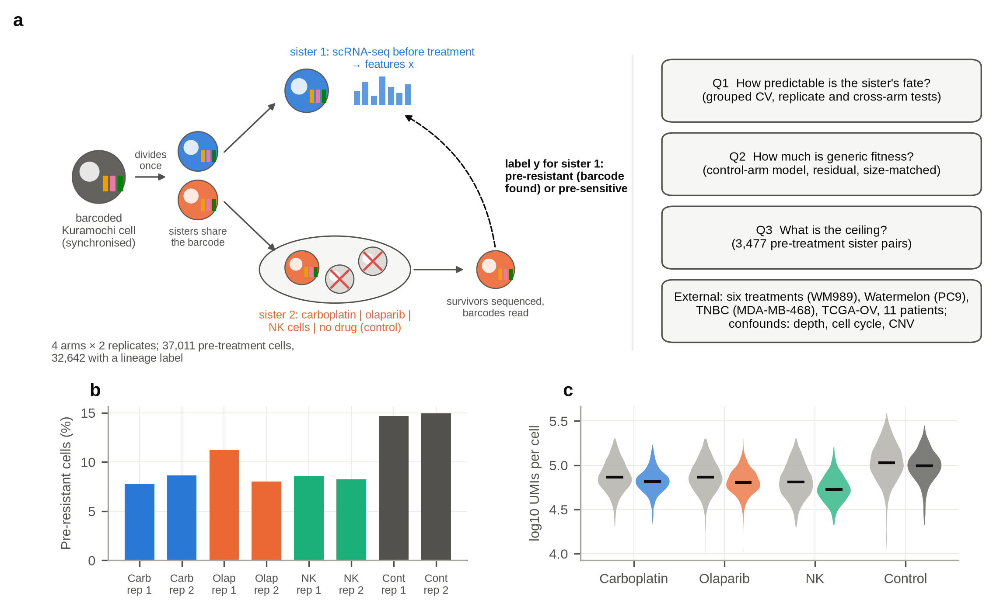

[PDF](Fig1_design_data.pdf)

### Figure 2. The pre-treatment state predicts a sister's fate: model comparison, replicate hold-out, benchmark protocol

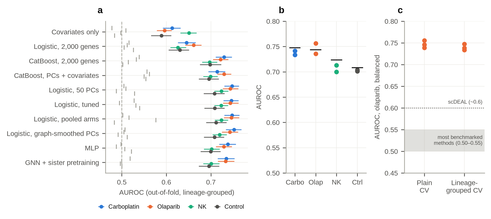

[PDF](Fig2_predictability.pdf)

### Figure 3. Most of the signal is shared with the untreated control: cross-arm transfer, fitness model, drug-specific gain and its split

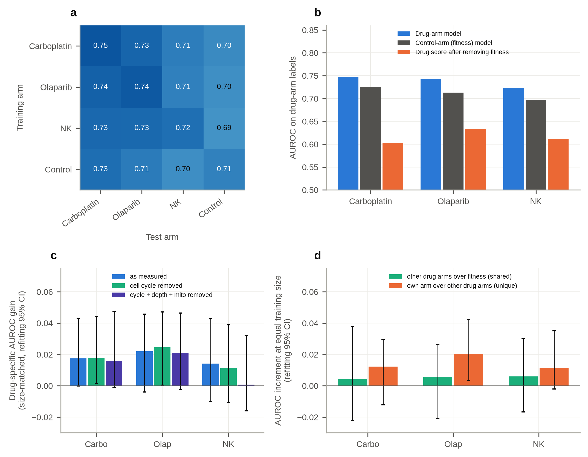

[PDF](Fig3_fitness_confound.pdf)

### Figure 4. Hallmark pathways of the shared and drug-specific components; copy-number clusters

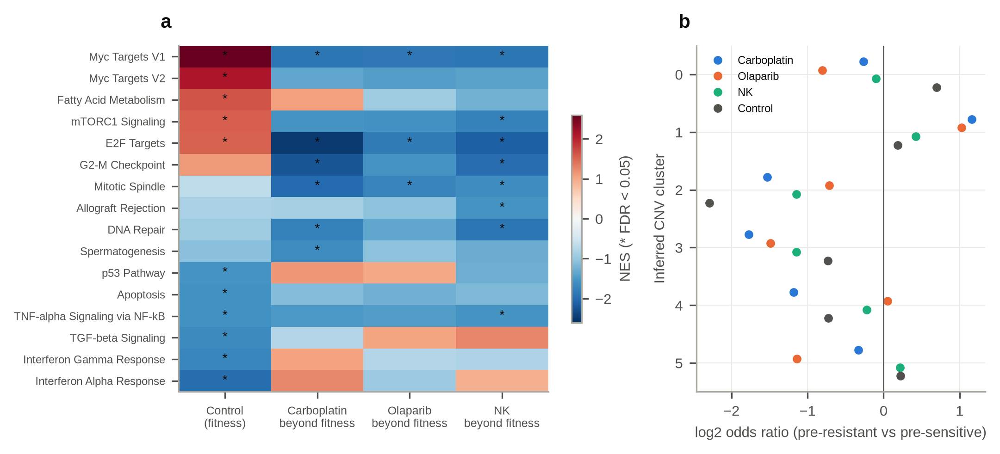

[PDF](Fig4_biology.pdf)

### Figure 5. Sister discordance caps predictability

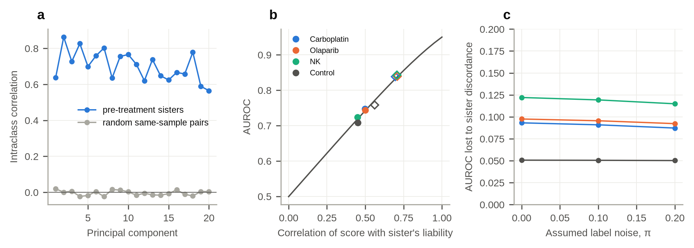

[PDF](Fig5_ceiling.pdf)

### Figure 6. Second lineage system with six treatments: clone size against expression

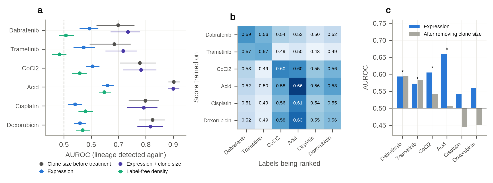

[PDF](Fig6_schaff_multitreatment.pdf)

### Figure 7. Two further lineage data sets, TCGA ovarian tumours and patients before and after chemotherapy

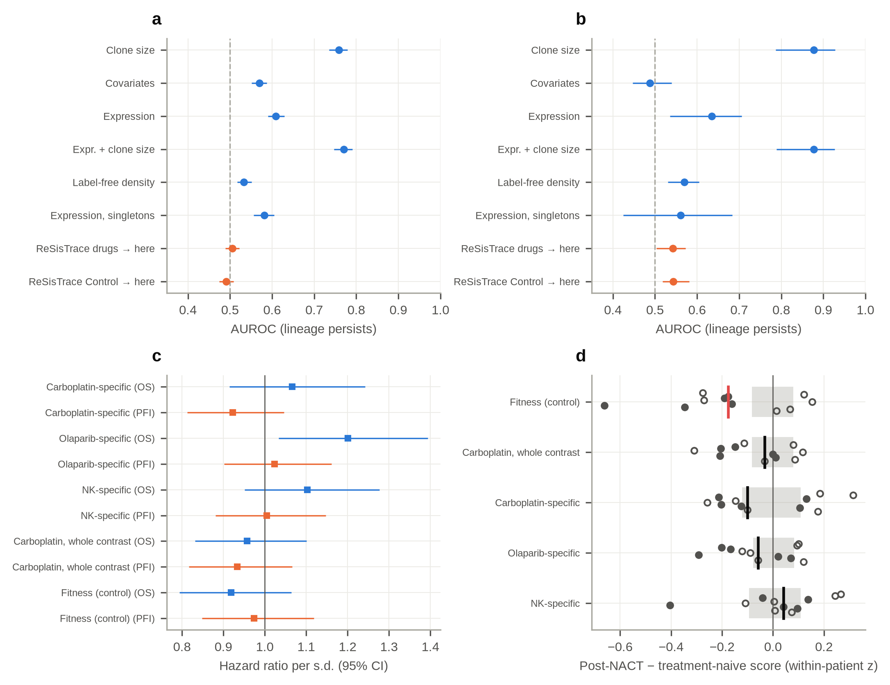

[PDF](Fig7_external_clinical.pdf)

### Supplementary Figure S1. Graph-network ablation

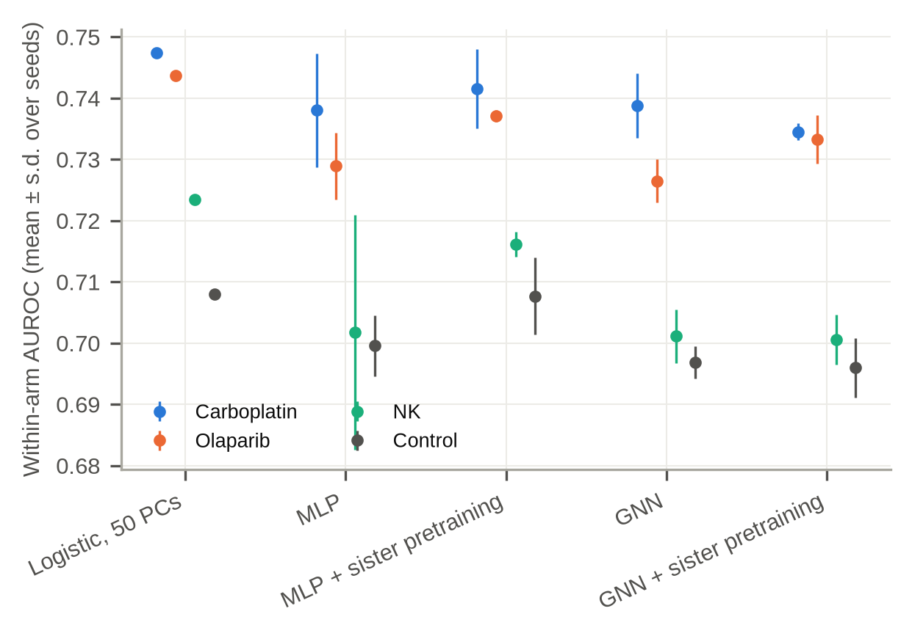

[PDF](FigS1_gnn_ablation.pdf)

### Supplementary Figure S2. Label-free density score

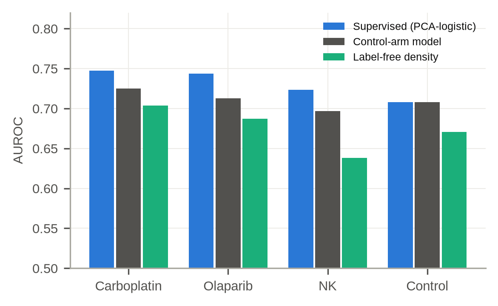

[PDF](FigS2_typicality.pdf)

### Supplementary Figure S3. Pre-specified marker genes

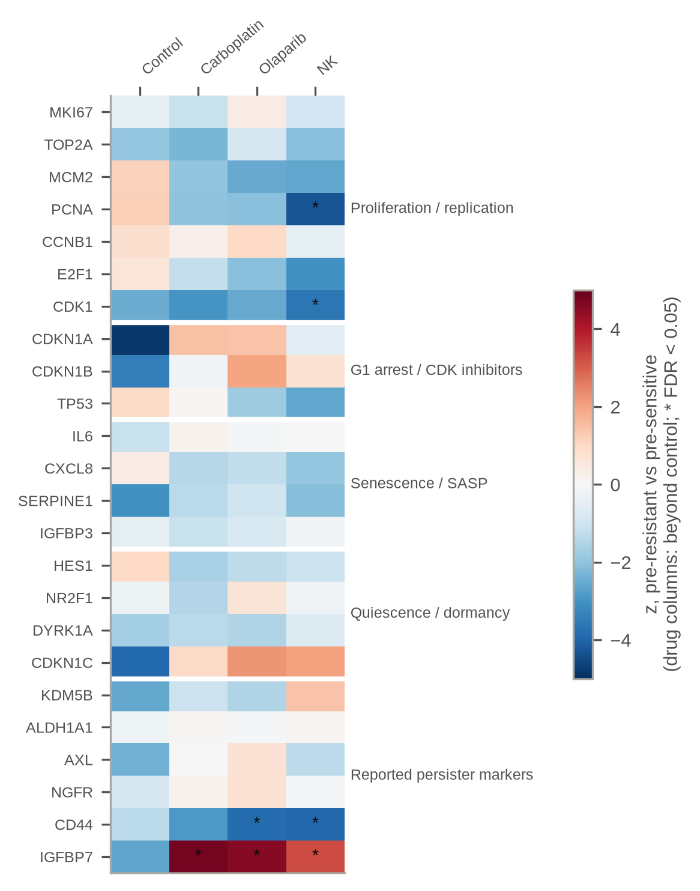

[PDF](FigS3_marker_panel.pdf)

### Supplementary Figure S4. Substitutes for an untreated arm

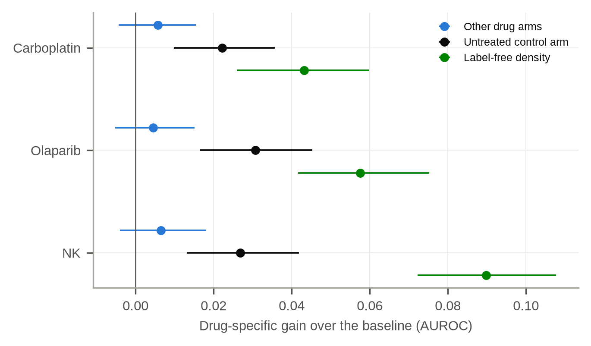

[PDF](FigS4_control_free.pdf)

### Supplementary Figure S5. The estimators checked on synthetic data with a known answer

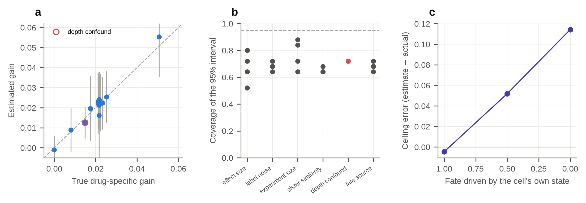

[PDF](FigS5_simulation.pdf)
